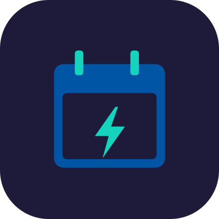

  

<h1 align="center">ClassVibe ⚡</h1>

<b>Your timetable, with attitude.</b> 
An offline Android timetable that reminds you before every class – with jokes.

  

## What is ClassVibe?

- 🔔 **Funny class reminders** – 600+ lines in 6 styles (incl. Tenglish & Hinglish), at the times you choose.
- 📸 **Import your timetable** from a screenshot, photo or CSV – read on your phone, nothing uploaded.
- 📝 **Exam planner** with countdown reminders, plus weekend prep.
- 📊 **Attendance & bunk planner** – know exactly how many classes you can skip and stay above 75%.
- 🔳 **Share with friends** by QR code, or **export to your calendar**.
- 🔒 **Private** – no account, no ads, no trackers. Your data stays on your phone.

## Download

👉 **[aksharganji23.github.io/ClassVibe](https://aksharganji23.github.io/ClassVibe/)** – or grab `ClassVibe-vX.Y.Z.apk` from [Releases](https://github.com/aksharganji23/ClassVibe/releases/latest).

Requires **Android 8.0+**. Free.

## Install guide

1. Open the link above **on your phone** and tap **Download**.
2. Open the downloaded `ClassVibe-v….apk` (notification or Downloads app).
3. If asked, allow **Install unknown apps** for your browser / Files app.
4. If Play Protect warns about an unknown developer: **More details → Install anyway**.
5. Open ClassVibe → import your timetable → done. 🎉

**Updates:** ClassVibe tells you when a new version is out – tap **Update** and it installs itself. Your data is kept.

## Tips for reliable reminders

- **Allow notifications** and **Alarms & reminders** when ClassVibe asks.
- On Xiaomi, Realme, Oppo, Vivo, OnePlus or Samsung: set ClassVibe's battery usage to **Unrestricted / No restrictions**, or the phone may silence reminders.
- Tap the **🔔** at the top of the app to send yourself a test reminder.
- Use **⚙️ → Backup** now and then – or switch on phone cloud backup – so a new phone gets your timetable back.

---

For developers: build, signing and release steps are in <a href="GUIDE.md">GUIDE.md</a> · changes in <a href="CHANGELOG.md">CHANGELOG.md</a>.
